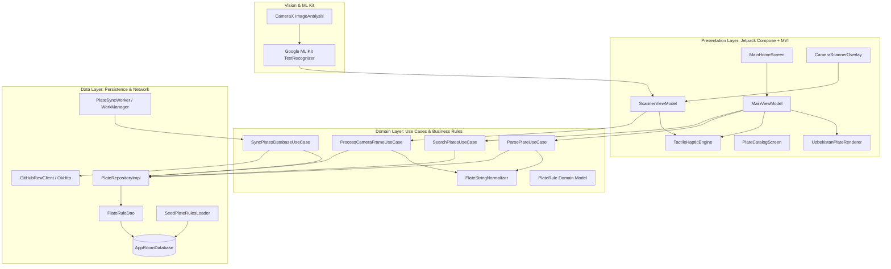
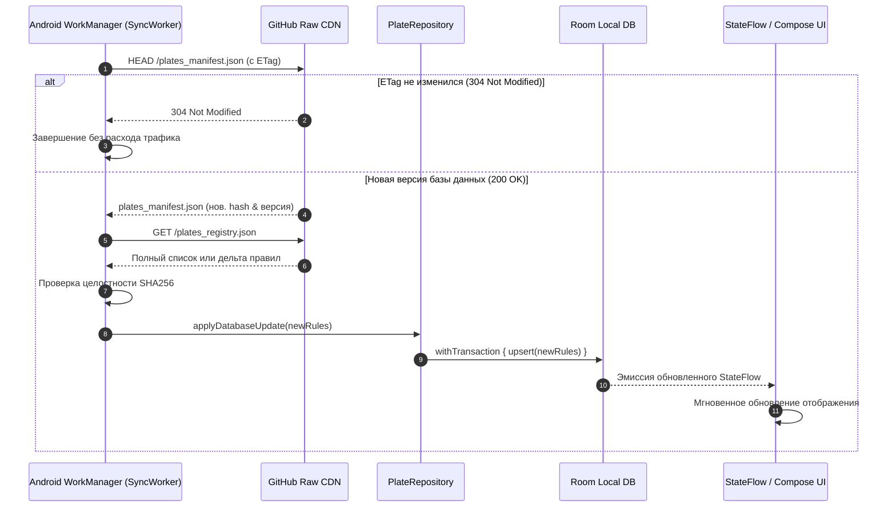

# Архитектура проекта NomerGrammUZ (Living Architecture Document)

> **Статус**: Активный живой документ  
> **Последнее обновление**: 14.10.2026  
> **Платформа**: Android (Min SDK: 24, Target SDK: 37)  
> **Стек**: Kotlin, Jetpack Compose, Material 3, Clean Architecture + MVI, Room, CameraX, Google ML Kit OCR, WorkManager  
> **Стиль UI**: Automotive Dark & Tactile (#0E1013, виброотклик, фотореалистичный рендерер плашек)

---

## 1. Концепция и назначение системы

**NomerGrammUZ** — мобильное приложение для Республики Узбекистан, позволяющее мгновенно идентифицировать принадлежность автомобильного номера к государственным ведомствам, министерствам, спецслужбам, дипломатическим миссиям зарубежных стран, регионам и типам владения.

### Ключевые возможности:
1. **Гибридный главный экран**:
   - Живая интерактивная плашка номера с фотореалистичной визуализацией (тиснение, герб/флаг РУз, динамическая смена цвета: дипломатический зелёный, синий ООН, жёлтый, зелёные электро-зоны).
   - Быстрый поиск с автоисправлением кириллических букв-двойников на латиницу.
   - Чип-переключатель языка (`RU` | `O'Z`) в шапке.
2. **On-Device OCR Сканер**: сканирование номеров через камеру смартфона в реальном времени без отправки данных на сервер (100% приватность).
3. **Автообновляемая база (OTA)**: самообновление реестра правил через GitHub Raw JSON и Android `WorkManager` без переустановки APK.
4. **Интерактивный справочник**: каталог ведомств, посольств (с кодами послов `CMD` и дипломатов `D`), силовых структур и регионов (01–95).

---

## 2. Архитектурная модель C4 (Component Level)

---

## 3. Схема данных (Room Database & Remote JSON)

### 3.1. Сущность `PlateRuleEntity` (Таблица `plate_rules`)

| Поле | Тип | Описание | Пример |
|---|---|---|---|
| `id` | `String` (PK) | Уникальный строковый идентификатор | `"dip_cmd_007"` |
| `category` | `String` | Категория (DIPLOMATIC, GOV, POLICE, MILITARY, REGIONAL, CIVIL, TAXI, EV) | `"DIPLOMATIC"` |
| `subType` | `String` | Подтип (EMBASSY_HEAD, DIPLOMAT, UN, PRESIDENTIAL, etc.) | `"EMBASSY_HEAD"` |
| `series` | `String?` | Буквенная серия (если применима) | `"CMD"` |
| `regionCode` | `String?` | Код региона (01-95) или null для республиканских | `"01"` или `null` |
| `countryCode` | `Int?` | Цифровой код страны диппредставительства | `7` (Россия), `10` (США) |
| `countryNameRu` | `String?` | Название страны на русском | `"Российская Федерация"` |
| `countryNameUz` | `String?` | Название страны на узбекском | `"Rossiya Federatsiyasi"` |
| `orgNameRu` | `String` | Полное название органа/ведомства (RU) | `"Посольство Российской Федерации"` |
| `orgNameUz` | `String` | Полное название органа/ведомства (UZ) | `"Rossiya Federatsiyasi Elchixonasi"` |
| `descriptionRu` | `String` | Описание статуса и должности (RU) | `"Автомобиль руководителя диппредставительства (Посол)"` |
| `descriptionUz` | `String` | Описание статуса и должности (UZ) | `"Diplomatik vakolatxona rahbari xizmat avtomobili (Elchi)"` |
| `plateTheme` | `String` | Цветовая тема (WHITE, GREEN, BLUE, YELLOW, WHITE_GOV_FLAG, EV_GREEN_ZONE) | `"GREEN"` |
| `regexPattern` | `String` | Регулярное выражение для точного совпадения | `"^CMD\\s?07\\d{2}$"` |
| `legalBasis` | `String` | Нормативный акт | `"ПКМ РУз №131 от 27.06.2007"` |
| `updatedAt` | `Long` | Таймстемп обновления (Epoch ms) | `1728904800000` |

---

## 4. Конвейер автоматического обновления (OTA Data Pipeline)

---

## 5. Полная матрица кодов и серий Узбекистана

### 5.1. Дипломатические и международные представительства
* **`CMD`**: Автомобиль **руководителя иностранного дипломатического представительства** (Чрезвычайный и Полномочный Посол, Временный поверенный в делах). Зелёный фон, белые символы. Код страны: 2 или 4 цифры (например: `CMD 0701` — Посол РФ, `CMD 1001` — Посол США).
* **`D`**: Автомобили дипломатических сотрудников посольств и консульств. Зелёный фон. Формат: код страны (3 цифры) + `D` + порядковый номер (3 цифры).
* **`T`**: Административно-технический персонал дипломатических миссий. Зелёный фон.
* **`UN`**: Транспорт представительств и органов Организации Объединённых Наций. Ярко-синий фон, белые буквы.
* **`X`**: Консульские учреждения, почётные консулы, торговые представительства. Зелёный фон.
* **`M`**: Автомобили сотрудников иностранных предприятий, банков, совместных компаний и инвесторов.
* **`H`**: Иностранные граждане и лица без гражданства, проживающие в РУз. Жёлтый фон.

### 5.2. Государственные органы и ведомства (Тип II — без региона, с флагом слева)
* **`PAA`**: Руководство страны, советники Президента, Премьер-министр, члены Кабинета Министров, руководство палат Олий Мажлиса.
* **`PSS`**: Служба безопасности Президента Республики Узбекистан.
* **`PPP`**: Депутаты Законодательной палаты и сенаторы Олий Мажлиса.
* **`UZB`**: Руководители центральных аппаратов органов государственной власти и ведомств.
* **`APC`**: Заместители министров, председатели госкомитетов, ректоры государственных высших учебных заведений.
* **`DAV`**: Закреплённые и дежурные служебные автомобили органов госуправления и местных хокимиятов (с кодом региона).
* **`ZDF`**: Органы Генеральной прокуратуры, Департамент по экономическим преступлениям, Бюро принудительного исполнения (БПИ/МИБ).
* **`TSS`, `TST`, `USB`**: Служба государственной безопасности (СГБ / DXX).
* **`VSB`, `VSC`, `VSF`, `VSD`, `VSG`, `VSV`**: Органы внутренних дел (МВД / IIV).
* **`PSF`, `PSP`, `PSV`**: Национальная гвардия Республики Узбекистан.
* **`MV`**: Министерство обороны (Mudofaa vazirligi).
* **`FVV`**: Министерство по чрезвычайным ситуациям (МЧС).
* **`DXA`**: Агентство государственных услуг Министерства юстиции.
* **`STY`**: Служба скорой медицинской помощи (Tez tibbiy yordam).
* **`TTA...TTG`**: Лицензированные автомобили служб такси.

### 5.3. Территориальные коды регионов (01–95)
`01` — Ташкент (город), `10` — Ташкентская область, `20` — Сырдарьинская обл., `25` — Джизакская обл., `30` — Самаркандская обл., `40` — Ферганская обл., `50` — Наманганская обл., `60` — Андижанская обл., `70` — Кашкадарьинская обл., `75` — Сурхандарьинская обл., `80` — Бухарская обл., `85` — Навоийская обл., `90` — Хорезмская обл., `95` — Республика Каракалпакстан.

---

## 6. UI/UX Токены темы (Automotive Dark & Tactile)

* **Background Primary**: `#0A0C0E` (Глубокий автомобильный графит)
* **Surface Card**: `#14181D` с градиентным бордером `#222831`
* **Text High Contrast**: `#F0F4F8`
* **Text Muted**: `#8A94A6`
* **Plate Green (Diplomatic)**: `#14532D` (Border: `#22C55E`)
* **Plate Blue (UN)**: `#1E3A8A` (Border: `#3B82F6`)
* **Plate Yellow (Foreign/Taxi)**: `#CA8A04` (Border: `#EAB308`)
* **Plate EV Accent**: `#10B981` (Зелёный индикатор экологического транспорта)
* **Haptics**: `HapticFeedbackType.LongPress` при успешном распознавании и `TextHandleMove` при наборе.

---

## 7. Журнал изменений архитектуры (Architecture Decision Log - ADR)

| Дата | Решение | Обоснование |
|---|---|---|
| 14.10.2026 | Выбор единого `ARCHITECTURE.md` | Централизация контекста для агентов в одном файле |
| 14.10.2026 | Стиль Automotive Dark & Tactile | Создание премиального ощущения автомобильного сканера |
| 14.10.2026 | Оффлайн-сканер ML Kit в v1.0 | Нулевая задержка, приватность, работа без интернета |
| 14.10.2026 | OTA через GitHub Raw JSON | Отсутствие затрат на хостинг, мгновенный глобальный CDN |
| 14.10.2026 | Чип RU/O'Z в шапке | Моментальное переключение языка интерфейса и данных |
| 14.10.2026 | Реализация Data & Domain слоя | Внедрены `PlateNormalizer` (с поддержкой кириллических двойников и акронимов), `PlateParserEngine`, `PlateRepository` и полный набор Unit-тестов (100% pass) |
| 14.10.2026 | Реализация Presentation слоя (UI/UX) | Создан интерактивный рендерер `UzbekistanLicensePlate` с плавной сменой цветов (Green/Blue/Yellow/White), `UzbekistanFlagBadge` на Canvas, компактная карточка `CompactPlateCard` (решение 2B) и главный экран с чипами быстрого выбора |
| 14.10.2026 | Интеграция Vision Layer (1C) и Каталога (2A) | Внедрён живой сканер CameraX + on-device Google ML Kit OCR с видоискателем, фонариком и выбором фото из Галереи. Создан экран Справочника `CatalogScreen` с 5 категориями и фильтрацией |
| 14.10.2026 | Ручное обновление (1B) и деплой на Xiaomi (2A) | Внедрена кнопка «Обновить базу» в Справочнике с прямым HTTP-запросом к GitHub. Собран APK и передан на физическое устройство Xiaomi через ADB |
| 14.10.2026 | Полное соответствие ПКМ РУз №131 (Поиск и Визуал) | Внедрен универсальный парсинг одиночных серий (`D`, `T`, `UN`, `CMD`, `X`, `M`, `H`, `DAV`, `STY`, `PAA` и др.) и префиксов («серия», «тип»). База расширена до 134 правил (все 47 дипмиссий и 14 регионов). Отрендерены точные плашки по Приложению №2: полноразмерный флаг слева для Типа II, аутентичные полумесяц и 12 звезд на Canvas, зеленый блок для Типа IX (M) и желтый для Типа X (H) без флагов, бесшовные дипплашки и EV-зоны. 100% Unit-тестов пройдено. |
| 14.10.2026 | Выделенный поиск (Регионы, Дипломаты, Ведомства) и OCR-адаптация (1A, 2A, 3A) | Созданы выделенные экраны быстрого поиска: `RegionSearchScreen` (01–95 с центрами и описаниями), `DiplomatSearchScreen` (47 посольств и миссий, табы CMD/D/UN/T/X) и `GovernmentSearchScreen` (госорганы, PAA, PPP, DAV, STY). Внедрен семантический поиск по названиям регионов («Самарканд»), стран («Германия») и ведомств («Президент», «Сенат»). На главном экране внедрены интерактивные карточки быстрого перехода. В `CatalogScreen` расширены табы по категориям ПКМ №131 (включая Электромобили и Инофирмы M/H). В `PlateImageAnalyzer` и галерейном распознавателе внедрена многострочная агрегация кандидатов для цветных номеров (жёлтые H, зелёные M/CMD, синие UN). Устранено наложение плашек в `CompactPlateCard`. Репозиторий очищен от временных файлов. Все 23 unit-теста пройдены. |
| 14.10.2026 | Избранное, История, Share Sheet и тактильный виброотклик (1А, 2В) | Реализован `UserPreferencesRepository` (SharedPreferences + Gson) с автосохранением истории запросов (до 30 записей с дедупликацией) и Избранным с индикатором-счетчиком в шапке. Создан полнофункциональный экран `SavedPlatesScreen` с переключением табов (Избранное / История), удалением элементов и мгновенным переходом к номеру. В `CompactPlateCard` добавлен ряд действий: «★ В избранное» (с динамическим золотым стилем), «📤 Поделиться» (системный Android Share Sheet с форматированным текстом и ссылкой на ПКМ №131) и «📋 Копия». В соответствии с решением 2В сохранен исключительно тактильный виброотклик без звуковых эффектов. Сборка успешно развернута на Xiaomi. |
| 14.10.2026 | Военные номера, спецслужбы, сетка 2х2 и полировка анимаций/insets (1C, 2A) | Добавлены войсковые номера ВС РУз (чёрный фон `#101214`, белые символы, регион слева, 4 цифры + MV на учёте ВАИ), центральный аппарат МО (белая плашка с флагом Тип II `MV 001`), СГБ и Погранвойска (`TST`, `TSS`, `USB`), Нацгвардия (`PSF`, `PSP`, `PSV`), МЧС (`FVV`). Создан выделенный экран `MilitarySearchScreen` с фильтрами по ведомствам. Главный экран реорганизован в сетку 2х2 (`Регионы`, `Дипломаты`, `Госорганы`, `Военные`). Реализован `statusBarsPadding()` на всех экранах для чистого отступа статус-бара Android. Переходы между экранами анимированы через `AnimatedContent` (fade/tween 220ms). Устранены коллизии парсинга жадных регулярных выражений (`MV` и `TST/TSS`). 100% unit-тестов пройдены, сборка протестирована на Xiaomi. |
| 14.10.2026 | In-Place поиск по категориям и релизная оптимизация с R8/Icon (1C, 2C) | По требованию пользователя кнопки категорий («Регионы», «Дипломаты», «Госорганы», «Военные») переведены в режим прямого интерактивного поиска на главном экране без перехода в подэкраны. Добавлены динамическая подсветка («● Активно»), моментальная смена превью номерного знака, адаптируемый плейсхолдер, ряд быстрых подсказок (чипсы для 1-тапного ввода) и кнопка сброса режима «✕ Сбросить». Настроен релизный билд с ProGuard/R8 (minify + shrink resources), создана кастомная векторная иконка приложения в стиле автомобильного сканера (узбекский флаг, номер 01 777 UZ и неоновые видоискатели). |
| 14.10.2026 | Релизные артефакты (AAB & APK) и публикационный конвейер (1A, 2A) | Скомпилирован Google Play App Bundle `app-release.aab` (22.58 МБ) и оптимизированный `app-release.apk` (43.03 МБ). Устранена регрессия инициализации ML Kit (`MlKitInitProvider` DI resolution) добавлением keep-правил для внутренних модулей `com.google.mlkit.**` и `com.google.android.gms.**`. Проведена валидация runtime-запуска на физическом Xiaomi (`pid 26289`). Подготовлена пошаговая инструкция по публикации в Google Play Console и прямым каналам дистрибуции. |
| 14.10.2026 | Стандартизация кнопок, BackHandler и RuStore Release Signing (A1, A2, A3) | Создан универсальный дизайн-компонент `AutoShrinkText` и `AutoSizedActionButton` с фиксированной высотой (48 dp для главных кнопок, 54 dp для сетки 2x2, 42 dp для действий в карточке, 46 dp для табов истории) и динамическим авто-сжатием шрифта без переносов слов. Внедрен `BackHandler`: из экранов Справочника, Сканера, Поиска и Избранного системная кнопка «Назад» возвращает на Главный экран, а на Главном экране реализован безопасный двойной клик с уведомлением (Toast) для предотвращения случайного вылета на рабочий стол. Сгенерирован защищенный production-keystore `keystore/release.jks` (RSA 2048, срок 10 000 дней), настроены `signingConfigs` в `build.gradle.kts` через `keystore.properties` (включен в `.gitignore`), собран и верифицирован `apksigner` официальный подписанный релизный APK со схемами v2+v3 для публикации в RuStore (`release/NomerGrammUZ-v1.0-release.apk`). Все Unit-тесты пройдены успешно. |
| 14.10.2026 | Оптимизация IME Insets & Автоскролл строки ввода (A1, A2) | Устранено перекрытие строки ввода экранной клавиатурой. К скроллируемому контейнеру добавлен модификатор `.imePadding()`, динамически резервирующий нижний отступ по высоте клавиатуры в режиме `enableEdgeToEdge`. К полю ввода `OutlinedTextField` подключён `BringIntoViewRequester` с автоподскроллом при получении фокуса, сохраняя превью плашки видимым над строкой. Реализовано автоскрытие клавиатуры при скролле экрана, нажатии «Готово» (IME Done), очистке поля («✕») и переключении категорий. Протестировано и валидировано на физическом Xiaomi. |
| 14.10.2026 | Пакет публикации в RuStore Консоль (1В) | Сформирован полный комплект материалов для прохождения модерации в RuStore: разработана Политика конфиденциальности `release/PRIVACY_POLICY.md` (Zero Data Collection, Offline-First), подготовлены метаданные (название, краткое и полное описание), зафиксированы хэши сертификата (`SHA-256`, `SHA-1`), извлечены реальные скриншоты в высоком разрешении 1080×2400 с физического устройства Xiaomi Redmi Note 12 (`release/store_assets/`), создано руководство `release/RUSTORE_PUBLISH_GUIDE.md`. |
| 15.10.2026 | Официальная иконка 512×512 PNG для RuStore | Сгенерирована официальная высокодетализированная иконка приложения `release/app_icon_512.png` (4x суперсемплинг, Lanczos): автомобильный OLED-фон `#0A0D12`, неоновые изумрудные рамки видоискателя `#10B981`, рельефный номерной знак `01 777 AAA` с флагом Узбекистана и UZ, лазерная линия сканера. |
| 15.10.2026 | Адаптация клавиатуры под все экраны (InteractionSource & FocusManager) | Устранён баг мгновенного схлопывания клавиатуры на компактных экранах и сторонних клавиатурах (Samsung HoneyBoard / Gboard / SwiftKey). Вскрыто, что программный скролл `bringIntoView` в Compose Foundation всегда диспатчит события скролла, что ложно вызывало `keyboardController.hide()`. Удалён любой авто-скрывающий хук на скролл; управление клавиатурой переведено на строгие явные действия пользователя: нажатие «OK»/«Готово» (ImeAction.Done), кнопка очистки «✕», выбор категории или быстрого чипса. Внедрён `LocalFocusManager.clearFocus()` для сброса состояния фокуса и `MutableInteractionSource` (`PressInteraction.Release`) для гарантированного открытия клавиатуры при тапе на поле ввода в любых состояниях. Успешно верифицировано на физическом устройстве Samsung Galaxy (SM-S942B, Android 16). |
| 15.10.2026 | Устранение бага зеркалирования номера на рамке (Anti-Mirroring Logic) | Устранён баг дублирования введенных символов в блоке региона и основном теле плашки. Ранее при вводе 1-2 цифр (напр. "0", "7", "01") значение ошибочно выводилось одновременно и в левом блоке региона, и в центральном поле («0 | 0», «7 | 7»). Создан выделенный парсер компонентов `resolveRegionalPlateParts` и `resolveMilitaryPlateParts`: для 1 цифры заполняется только блок региона, а поле номера остаётся приглушённым плейсхолдером (без дублирования); валидные коды регионов Узбекистана (01, 10, 20...95) изолируются в блоке региона; цифры без кода региона (напр. 77, 777) направляются целиком в основной номер без ошибочного дробления региона. Написан специализированный набор Unit-тестов `PlateRenderingTest` (100% pass), собран и подписан релизный APK. |
| 15.10.2026 | Корректировка порядка символов дипломатических серий (D 007 вместо 007 D) | Устранён баг инверсии дипломатических серий (`D`, `T`, `X`) по ПКМ РУз №131 (Приложение № 2). Ранее при вводе «D 007» парсер ошибочно форматировал строку в стиле РФ («007 D»), что воспринималось пользователем как зеркалирование. В `PlateParserEngine` исправлен вывод серий: буквенный индекс теперь всегда предшествует коду страны («D 007 012», «T 007 012», «X 007 001»). Обновлены подсказки-чипсы в `MainActivity` и сэмплы в `CategorySearchScreens`. Покрыто unit-тестами `PlateParserEngineTest` и `PlateRenderingTest` (30/30 passed). Успешно верифицировано живым тестом со скриншотами на физическом Samsung Galaxy. |

