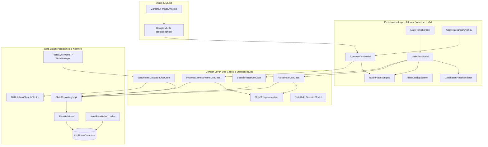
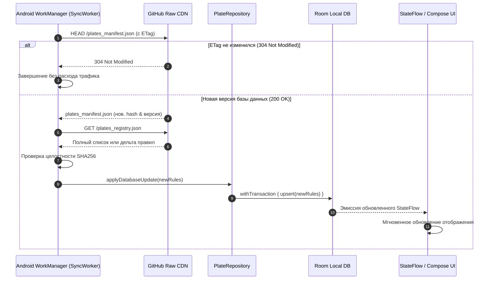

# Архитектура проекта NomerGrammUZ (Living Architecture Document)

> **Статус**: Активный живой документ  
> **Последнее обновление**: 14.10.2026  
> **Платформа**: Android (Min SDK: 24, Target SDK: 37)  
> **Стек**: Kotlin, Jetpack Compose, Material 3, Clean Architecture + MVI, Room, CameraX, Google ML Kit OCR, WorkManager  
> **Стиль UI**: Automotive Dark & Tactile (#0E1013, виброотклик, фотореалистичный рендерер плашек)

---

## 1. Концепция и назначение системы

**NomerGrammUZ** — мобильное приложение для Республики Узбекистан, позволяющее мгновенно идентифицировать принадлежность автомобильного номера к государственным ведомствам, министерствам, спецслужбам, дипломатическим миссиям зарубежных стран, регионам и типам владения.

### Ключевые возможности:
1. **Гибридный главный экран**:
   - Живая интерактивная плашка номера с фотореалистичной визуализацией (тиснение, герб/флаг РУз, динамическая смена цвета: дипломатический зелёный, синий ООН, жёлтый, зелёные электро-зоны).
   - Быстрый поиск с автоисправлением кириллических букв-двойников на латиницу.
   - Чип-переключатель языка (`RU` | `O'Z`) в шапке.
2. **On-Device OCR Сканер**: сканирование номеров через камеру смартфона в реальном времени без отправки данных на сервер (100% приватность).
3. **Автообновляемая база (OTA)**: самообновление реестра правил через GitHub Raw JSON и Android `WorkManager` без переустановки APK.
4. **Интерактивный справочник**: каталог ведомств, посольств (с кодами послов `CMD` и дипломатов `D`), силовых структур и регионов (01–95).

---

## 2. Архитектурная модель C4 (Component Level)

---

## 3. Схема данных (Room Database & Remote JSON)

### 3.1. Сущность `PlateRuleEntity` (Таблица `plate_rules`)

| Поле | Тип | Описание | Пример |
|---|---|---|---|
| `id` | `String` (PK) | Уникальный строковый идентификатор | `"dip_cmd_007"` |
| `category` | `String` | Категория (DIPLOMATIC, GOV, POLICE, MILITARY, REGIONAL, CIVIL, TAXI, EV) | `"DIPLOMATIC"` |
| `subType` | `String` | Подтип (EMBASSY_HEAD, DIPLOMAT, UN, PRESIDENTIAL, etc.) | `"EMBASSY_HEAD"` |
| `series` | `String?` | Буквенная серия (если применима) | `"CMD"` |
| `regionCode` | `String?` | Код региона (01-95) или null для республиканских | `"01"` или `null` |
| `countryCode` | `Int?` | Цифровой код страны диппредставительства | `7` (Россия), `10` (США) |
| `countryNameRu` | `String?` | Название страны на русском | `"Российская Федерация"` |
| `countryNameUz` | `String?` | Название страны на узбекском | `"Rossiya Federatsiyasi"` |
| `orgNameRu` | `String` | Полное название органа/ведомства (RU) | `"Посольство Российской Федерации"` |
| `orgNameUz` | `String` | Полное название органа/ведомства (UZ) | `"Rossiya Federatsiyasi Elchixonasi"` |
| `descriptionRu` | `String` | Описание статуса и должности (RU) | `"Автомобиль руководителя диппредставительства (Посол)"` |
| `descriptionUz` | `String` | Описание статуса и должности (UZ) | `"Diplomatik vakolatxona rahbari xizmat avtomobili (Elchi)"` |
| `plateTheme` | `String` | Цветовая тема (WHITE, GREEN, BLUE, YELLOW, WHITE_GOV_FLAG, EV_GREEN_ZONE) | `"GREEN"` |
| `regexPattern` | `String` | Регулярное выражение для точного совпадения | `"^CMD\\s?07\\d{2}$"` |
| `legalBasis` | `String` | Нормативный акт | `"ПКМ РУз №131 от 27.06.2007"` |
| `updatedAt` | `Long` | Таймстемп обновления (Epoch ms) | `1728904800000` |

---

## 4. Конвейер автоматического обновления (OTA Data Pipeline)

---

## 5. Полная матрица кодов и серий Узбекистана

### 5.1. Дипломатические и международные представительства
* **`CMD`**: Автомобиль **руководителя иностранного дипломатического представительства** (Чрезвычайный и Полномочный Посол, Временный поверенный в делах). Зелёный фон, белые символы. Код страны: 2 или 4 цифры (например: `CMD 0701` — Посол РФ, `CMD 1001` — Посол США).
* **`D`**: Автомобили дипломатических сотрудников посольств и консульств. Зелёный фон. Формат: код страны (3 цифры) + `D` + порядковый номер (3 цифры).
* **`T`**: Административно-технический персонал дипломатических миссий. Зелёный фон.
* **`UN`**: Транспорт представительств и органов Организации Объединённых Наций. Ярко-синий фон, белые буквы.
* **`X`**: Консульские учреждения, почётные консулы, торговые представительства. Зелёный фон.
* **`M`**: Автомобили сотрудников иностранных предприятий, банков, совместных компаний и инвесторов.
* **`H`**: Иностранные граждане и лица без гражданства, проживающие в РУз. Жёлтый фон.

### 5.2. Государственные органы и ведомства (Тип II — без региона, с флагом слева)
* **`PAA`**: Руководство страны, советники Президента, Премьер-министр, члены Кабинета Министров, руководство палат Олий Мажлиса.
* **`PSS`**: Служба безопасности Президента Республики Узбекистан.
* **`PPP`**: Депутаты Законодательной палаты и сенаторы Олий Мажлиса.
* **`UZB`**: Руководители центральных аппаратов органов государственной власти и ведомств.
* **`APC`**: Заместители министров, председатели госкомитетов, ректоры государственных высших учебных заведений.
* **`DAV`**: Закреплённые и дежурные служебные автомобили органов госуправления и местных хокимиятов (с кодом региона).
* **`ZDF`**: Органы Генеральной прокуратуры, Департамент по экономическим преступлениям, Бюро принудительного исполнения (БПИ/МИБ).
* **`TSS`, `TST`, `USB`**: Служба государственной безопасности (СГБ / DXX).
* **`VSB`, `VSC`, `VSF`, `VSD`, `VSG`, `VSV`**: Органы внутренних дел (МВД / IIV).
* **`PSF`, `PSP`, `PSV`**: Национальная гвардия Республики Узбекистан.
* **`MV`**: Министерство обороны (Mudofaa vazirligi).
* **`FVV`**: Министерство по чрезвычайным ситуациям (МЧС).
* **`DXA`**: Агентство государственных услуг Министерства юстиции.
* **`STY`**: Служба скорой медицинской помощи (Tez tibbiy yordam).
* **`TTA...TTG`**: Лицензированные автомобили служб такси.

### 5.3. Территориальные коды регионов (01–95)
`01` — Ташкент (город), `10` — Ташкентская область, `20` — Сырдарьинская обл., `25` — Джизакская обл., `30` — Самаркандская обл., `40` — Ферганская обл., `50` — Наманганская обл., `60` — Андижанская обл., `70` — Кашкадарьинская обл., `75` — Сурхандарьинская обл., `80` — Бухарская обл., `85` — Навоийская обл., `90` — Хорезмская обл., `95` — Республика Каракалпакстан.

---

## 6. UI/UX Токены темы (Automotive Dark & Tactile)

* **Background Primary**: `#0A0C0E` (Глубокий автомобильный графит)
* **Surface Card**: `#14181D` с градиентным бордером `#222831`
* **Text High Contrast**: `#F0F4F8`
* **Text Muted**: `#8A94A6`
* **Plate Green (Diplomatic)**: `#14532D` (Border: `#22C55E`)
* **Plate Blue (UN)**: `#1E3A8A` (Border: `#3B82F6`)
* **Plate Yellow (Foreign/Taxi)**: `#CA8A04` (Border: `#EAB308`)
* **Plate EV Accent**: `#10B981` (Зелёный индикатор экологического транспорта)
* **Haptics**: `HapticFeedbackType.LongPress` при успешном распознавании и `TextHandleMove` при наборе.

---

## 7. Журнал изменений архитектуры (Architecture Decision Log - ADR)

| Дата | Решение | Обоснование |
|---|---|---|
| 14.10.2026 | Выбор единого `ARCHITECTURE.md` | Централизация контекста для агентов в одном файле |
| 14.10.2026 | Стиль Automotive Dark & Tactile | Создание премиального ощущения автомобильного сканера |
| 14.10.2026 | Оффлайн-сканер ML Kit в v1.0 | Нулевая задержка, приватность, работа без интернета |
| 14.10.2026 | OTA через GitHub Raw JSON | Отсутствие затрат на хостинг, мгновенный глобальный CDN |
| 14.10.2026 | Чип RU/O'Z в шапке | Моментальное переключение языка интерфейса и данных |
